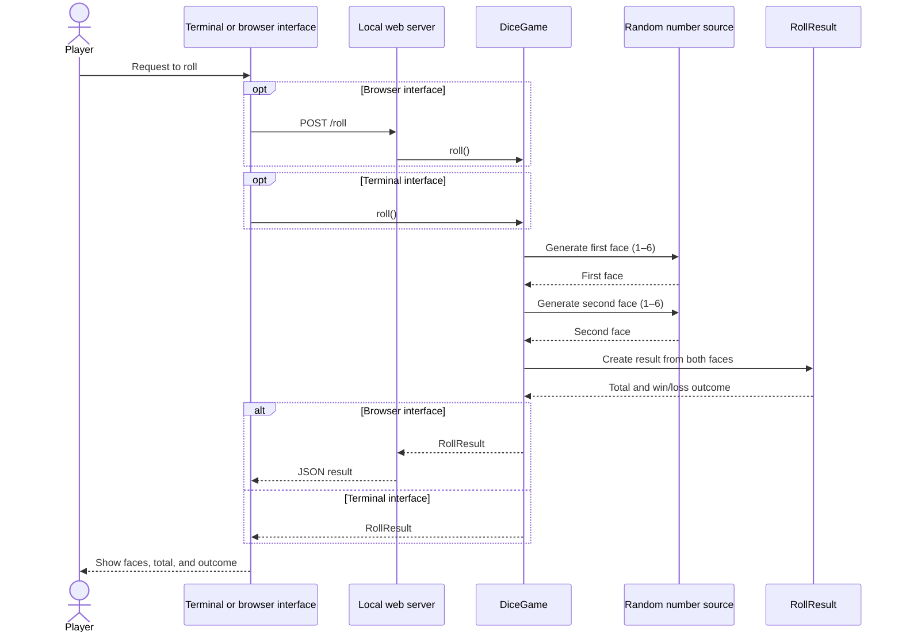
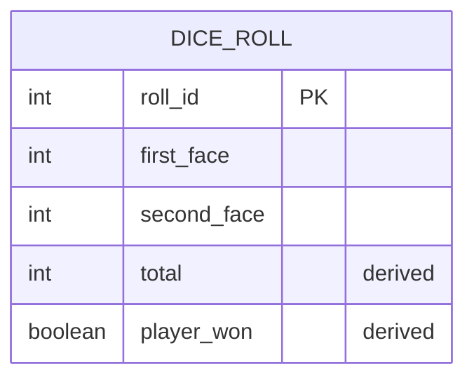

# Dice Game — Design

## Scope

The first version implements one rule: when the player requests a roll, the
system rolls two six-sided dice. A total of seven means the player wins;
otherwise, the player loses. The game can be played in a terminal or through a
local browser interface. It has no database.

## Domain model

### Ubiquitous language

| Term | Meaning |
|---|---|
| Dice roll | The two face values produced for one player request |
| Total | The sum of the two face values |
| Win | A roll whose total is exactly seven |
| Loss | A roll whose total is not seven |

### Model

- **`DiceGame`** creates a roll by requesting a random face from each die.
- **`RollResult`** is an immutable value object containing both face values.
  It calculates the total and whether the player won, so the rule lives with
  the domain data it evaluates.
- **Interfaces** ask the player to roll and present the result. They do not
  decide the outcome. The browser interface sends a request to the local web
  server, which uses the same domain model as the terminal interface.
- A random-number source can be supplied to `DiceGame` for repeatable tests.

The first version has no player account, score, or persistent game session:
those concepts are intentionally left for future requirements.

## System sequence diagram

## ER diagram

There is no database in this version, so the following is a conceptual ER
diagram for a possible future feature that stores rolls. It is not implemented
by the current Python code.

The stored face values are the facts of a roll. `total` and `player_won` can be
calculated from them using the game rule.

## Requirement traceability

| Requirement | Implementation |
|---|---|
| Player requests to roll | Terminal prompts for Enter; browser provides a Roll button |
| System rolls dice | `DiceGame.roll()` generates two faces from 1 through 6 |
| Total of seven wins | `RollResult.player_won` is true exactly when the total is 7 |
| Otherwise, player loses | The interface displays a loss for every other total |

## Local web interface

Run `python3 -m dice_game.web` from the directory containing the package, then
open `http://127.0.0.1:8000`. The page is served by the Python standard library.
Its `POST /roll` endpoint returns the two die faces, total, and win status as
JSON.
